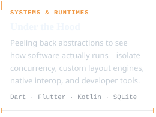
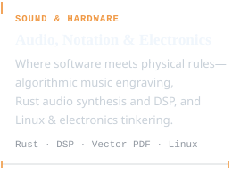
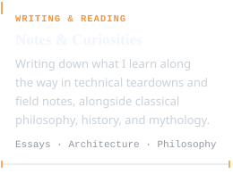

<picture>
  <source media="(prefers-color-scheme: dark)" srcset="assets/header-dark.svg">
  <source media="(prefers-color-scheme: light)" srcset="assets/header-light.svg">
  
</picture>

Coming into software from board-level hardware repair, networking, and Linux administration leaves a permanent mark: once you've traced enough dead circuits and dropped packets, you stop treating abstractions as magic. Today, whether I'm building low-level engines, developer tooling, or cross-platform applications, my instinct is still to open up the black box, understand what the machine is doing underneath, and keep things simple, inspectable, and out of the way.

Shipping commercial systems and leading small teams taught me the other half of the craft—that good software depends just as much on honest communication and a culture where ideas can breathe as it does on clean architecture. This space is my public workbench: open-source tools born from real engineering friction, experiments where code meets sound, and whatever rabbit hole I'm currently exploring. Still plenty left to learn, which is what keeps it interesting.

  <picture>
    <source media="(prefers-color-scheme: dark)" srcset="assets/pillar-systems-dark.svg">
    <source media="(prefers-color-scheme: light)" srcset="assets/pillar-systems-light.svg">
    
  </picture>
  <picture>
    <source media="(prefers-color-scheme: dark)" srcset="assets/pillar-sound-dark.svg">
    <source media="(prefers-color-scheme: light)" srcset="assets/pillar-sound-light.svg">
    
  </picture>
  <picture>
    <source media="(prefers-color-scheme: dark)" srcset="assets/pillar-writing-dark.svg">
    <source media="(prefers-color-scheme: light)" srcset="assets/pillar-writing-light.svg">
    
  </picture>

  <a href="https://github.com/pccria/resume/releases/latest/download/PooriaAskariMoqaddam.resume.pdf" target="_blank" rel="noopener noreferrer"><picture>
    <source media="(prefers-color-scheme: dark)" srcset="assets/contact-resume-dark.svg">
    <source media="(prefers-color-scheme: light)" srcset="assets/contact-resume-light.svg">
    
  </picture></a>
  <a href="https://www.linkedin.com/in/pooriaaskarim/" target="_blank" rel="noopener noreferrer"><picture>
    <source media="(prefers-color-scheme: dark)" srcset="assets/contact-linkedin-dark.svg">
    <source media="(prefers-color-scheme: light)" srcset="assets/contact-linkedin-light.svg">
    
  </picture></a>
  <a href="mailto:pooriaaskarim@gmail.com" target="_blank" rel="noopener noreferrer"><picture>
    <source media="(prefers-color-scheme: dark)" srcset="assets/contact-email-dark.svg">
    <source media="(prefers-color-scheme: light)" srcset="assets/contact-email-light.svg">
    
  </picture></a>

